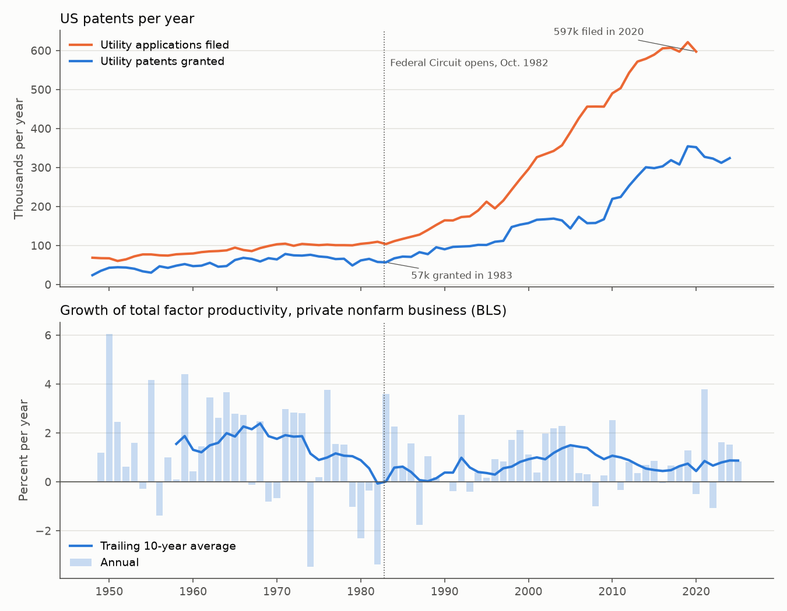
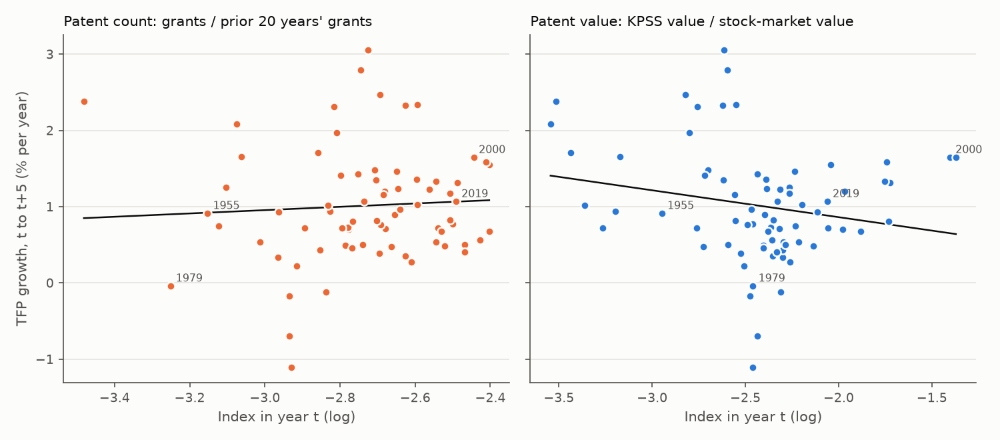

# Six Times the Patents, No Faster Progress

### In 2008, Michele Boldrin and David Levine asked whether America's patent explosion bought any extra technological progress. I asked again with data through 2025.

---

Between 2015 and 2024 the US Patent and Trademark Office granted IBM 70,954 patents, more than any other American
company and 2.2% of every utility patent the office issued in those ten years. Apple received 24,112. Nvidia received 2,666. Behind each of those grants is a
document that gives its owner the right, for twenty years from filing, to stop anyone else from making, using or selling the
thing it describes.

The patent office is far busier than it used to be. In 1983 it granted 56,860 utility patents, the kind that cover
inventions rather than ornamental designs or plants. In 2020 it granted 352,066, and applications reached 597,175. If
each patent marks a new idea, the American economy should be producing ideas at six times its old rate, and the
productivity of its workers and machines should be rising faster than ever. Two economists at Washington University
in St. Louis looked at the same climb, through 2010, and saw no acceleration at all. They concluded that patents are
mostly used for arms races between firms rather than to protect new ideas, and that the country would be better off
abolishing them.

---

## Measuring progress, and what a patent buys

Economists measure technological progress with total factor productivity, or TFP, which measures how much output an economy
gets from a fixed amount of labor and capital. If a factory produces more cars with the same workers, machines and steel,
its TFP has risen. The Bureau of Labor Statistics publishes an index for the private nonfarm business sector, set to
100 in 2017, and the growth rate is its log change:

```math
g_t = 100 \times \left(\ln A_t - \ln A_{t-1}\right)
```

Here $`A_t`$ is the TFP index in year $`t`$ and $`g_t`$ is its growth in percent. The index stood at 107.546 in 2024 and
108.441 in 2025, so

```math
g_{2025} = 100 \times \ln\!\left(\frac{108.441}{107.546}\right) = 0.83\%
```

To ask what the patent system buys, I divide a decade's average TFP growth by its average number of utility grants,
measured in units of 100,000 patents. Call it progress per patent:

```math
\kappa = \frac{\bar{g}}{\bar{P}/100{,}000}
```

In the 1960s TFP grew 1.87% a year while the office granted an average of 56,786 utility patents, so
$`\kappa = 1.870 / 0.568 = 3.29`$ percentage points of growth per 100,000 patents. In the 2010s TFP grew 0.745% a
year on 285,826 patents, and $`\kappa = 0.745 / 2.858 = 0.26`$.

| Decade | Average utility grants per year | TFP growth per year | Progress per 100,000 patents |
|---|---|---|---|
| 1950s | 42,599 | 1.87% | 4.40 points |
| 1980s | 70,847 | 0.15% | 0.21 points |
| 2010s | 285,826 | 0.75% | 0.26 points |

If patents were a steady measure of new ideas, this number would hold roughly constant. It fell by more than 90%
between the 1950s and the 2010s.

---

## Two economists against intellectual monopoly

Michele Boldrin was born in Padova in 1956, studied economics at Ca' Foscari in Venice and took his PhD at the
University of Rochester. He became the Joseph Gibson Hoyt Distinguished Professor in Arts and Sciences at Washington
University in St. Louis, working on growth, business cycles and dynamic general equilibrium. David Levine taught at
UCLA, where he held the Armen Alchian Chair, before moving to Washington University as the John H. Biggs
Distinguished Professor. He wrote *The Theory of Learning in Games* with Drew Fudenberg and now holds a
professorship at Royal Holloway, University of London. In 2008 the two published *Against Intellectual Monopoly*
with Cambridge University Press and put the whole text online for free. In 2013 they compressed the argument into "The Case Against Patents" in the
*Journal of Economic Perspectives*.

Their theory begins with an observation about who gets rich from new things. The first company to market with a
good idea earns money before imitators catch up, and that head start can be enough. An innovator facing a fixed
development cost $`F`$, who earns profits $`\pi_s`$ in each year $`s`$ before rivals copy it after $`T`$ years and discounts
the future by a factor $`\rho`$ per year, will go ahead whenever

```math
\sum_{s=0}^{T-1} \rho^{s}\, \pi_s \;\ge\; F
```

A patent stretches $`T`$ to twenty years, which raises the reward to the first inventor. Boldrin and Levine argue that
it also hands every later inventor a toll to pay, invites firms to stockpile patents for lawsuits, and draws money into
lobbying for stronger protection. Their working-paper version gives the numbers that anchor the case. In 1983 the
office issued 59,715 patents; by 2010 it issued 244,341. "In less than thirty years, the flow of patents roughly
quadrupled," they wrote, while productivity showed no upward trend.

The test behind that sentence rests on one link. Suppose each patent is an idea that raises TFP by a small fixed
fraction $`\theta`$, ideas are independent, and nothing else changes TFP except a constant background rate
$`\alpha`$. With $`P_t`$ patents in year $`t`$,

```math
\begin{aligned}
A_t &= e^{\alpha/100}\, A_{t-1}\,(1+\theta)^{P_t} \\
\ln A_t - \ln A_{t-1} &= \alpha/100 + P_t \ln(1+\theta) \\
g_t &\approx \alpha + 100\,\theta\, P_t
  = \alpha + \kappa\,\frac{P_t}{100{,}000}
\end{aligned}
```

The last line uses $`\ln(1+\theta) \approx \theta`$ for small $`\theta`$ and writes $`\kappa = 10^{7}\theta`$, the progress
per 100,000 patents defined above. If patents carry ideas of roughly constant size, TFP growth should rise in step
with the number of patents, and a quadrupling of patents should show up as a much faster rate of progress.

The strongest objection is that a patent count treats a trivial patent the same as a breakthrough. Leonid Kogan,
Dimitris Papanikolaou, Amit Seru and Noah Stoffman (2017, *Quarterly Journal of Economics*) measured what each patent
was worth from the owner's stock-market reaction on the day it was granted, for every patent held by a listed US firm
since 1926. Their summary says that, aggregated, this measure "accounts for significant medium-run fluctuations in
aggregate economic growth and TFP." If counts fail because they weigh junk and gold equally, value might succeed.

---

## How I tested it

I rebuilt Boldrin and Levine's comparison from the USPTO's own tables of applications and grants by calendar year,
which run from 1790 to 2020, and extended the grant counts to 2024 with PatentsView, the patent office's research
database. The two sources agree within 0.1% in every year they overlap. For productivity I used the BLS total factor
productivity index for private nonfarm business, 1948 to 2025, and checked every result against John Fernald's
utilization-adjusted series from the Federal Reserve Bank of San Francisco, which strips out the swings in TFP that
come from factories running harder in booms. I kept the paper's starting year, 1983, which is also the first full year of the
Court of Appeals for the Federal Circuit. The authors describe that court, created by Congress in 1982, as biased
toward enlarging patent rights. I also kept their unit, a patent counted in the year it issues.

The tests follow the derivation above. The first regresses annual TFP growth on the number of utility grants, and the
second on a dummy for the years from 1983 on:

```math
\begin{aligned}
g_t &= \alpha + \kappa\, \frac{P_t}{100{,}000} + \varepsilon_t,
  \qquad H_0:\ \kappa = 0 \\
g_t &= \alpha + \delta\, \mathbf{1}[t \ge 1983] + u_t,
  \qquad H_0:\ \delta = 0
\end{aligned}
```

A third asks whether growth in patenting this year or in any of the previous five predicts TFP growth, summing the six
coefficients $`\beta_k`$ on $`\Delta \ln P_{t-k}`$. Annual TFP growth is noisy and serially correlated, so standard
errors are Newey-West with three lags.

For the extension I followed Kogan and his coauthors. I summed their value $`\xi_i`$ over every patent granted in year
$`t`$ and divided by the stock-market value of US nonfinancial corporations from the Federal Reserve's Financial
Accounts, $`M_t`$. I compared this value index with two count measures, grants this year relative to grants over the previous
twenty years and the growth rate of grants, and asked which predicts average TFP growth over the next $`h`$ years:

```math
\begin{aligned}
\bar{g}_{t,h} &= \frac{100}{h}\left(\ln A_{t+h} - \ln A_t\right) \\
\bar{g}_{t,h} &= a + b\, z_t + c\,\frac{t - 1948}{10} + e_t,
  \qquad H_0:\ b = 0
\end{aligned}
```

Here $`z_t`$ is the value index $`\ln(\sum_i \xi_i / M_t)`$, the count index $`\ln(P_t / \sum_{s=t-20}^{t-1} P_s)`$ or the
growth of grants $`\Delta \ln P_t`$, standardized so $`b`$ is the change in annual TFP growth per standard deviation. I ran each with and without the time trend and with controls for
current TFP growth and stock-market growth, for $`h`$ of 1, 3 and 5 years, with Newey-West lags of at least $`h`$.

---

## Patents rose sixfold and productivity growth did not rise

| Period | Utility grants per year | Patent growth per year | TFP growth per year (BLS) | TFP growth, utilization-adjusted | Private R&D, % of GDP |
|---|---|---|---|---|---|
| 1953–1982 | 57,959 | 0.9% | 1.09% | 1.62% | 0.97% |
| 1983–2010 | 124,112 | 4.8% | 0.98% | 0.97% | 1.67% |
| 2011–2025 | 305,509 | 2.8% | 0.74% | 0.76% | 2.38% |

The paper's figures hold up against the current USPTO table. The 2010 total of 244,341 grants matches exactly. The
1983 figure differs slightly from today's revised count of 61,982, so the ratio comes out at 3.94 rather than the
paper's 4.09. Utility grants alone rose 6.19 times from 1983 to 2020 and 5.70 times to 2024.

TFP rose 42% in the 42 years from 1983 to 2025. It rose 42% in the 30 years from 1953 to 1983, on far fewer patents.
The era regression puts the change in BLS TFP growth from 1983 on, relative to 1949–1982, at

```math
\hat{\delta} = -0.37\ (0.46),\quad 95\%\ \text{CI}\ [-1.28,\ 0.54],\quad N = 77
```

which is negative and indistinguishable from zero. On Fernald's utilization-adjusted series the change is
$`\hat{\delta} = -0.72\ (0.30)`$, a slowdown that clears the 5% significance bar.

One thing did rise in step with patents. Private R&D investment, as BEA measures it, went from 0.97% of GDP before
1983 to 2.38% since 2011. The paper says R&D expenditure showed no particular upward trend without naming a series, and
on this private measure that statement does not hold over the longer record. Companies are spending more on research
and filing many more patents, and measured productivity growth has not responded to either.



---

## Year to year, more patents do not mean faster growth

Era averages could hide a link that works with a lag. The annual regressions find none.

```math
\begin{aligned}
\hat{\kappa} &= -0.17\ (0.16),\quad 95\%\ \text{CI}\ [-0.48,\ 0.14],\quad N = 76 \\
\textstyle\sum_{k=0}^{5}\hat{\beta}_k &= 0.012\ (0.067),\quad \text{joint } p = 0.85,\quad N = 71
\end{aligned}
```

The first line says that an extra 100,000 patents in a year goes with TFP growth 0.17 points lower, not higher, and
the interval runs from a modest negative effect to a small positive one. The second says that a burst of patenting
predicts nothing about productivity over the following five years. Using applications in place of grants gives
$`-0.15\ (0.08)`$. Labor productivity, output per hour, gives $`-0.20\ (0.18)`$. Grouping the years into fifteen
non-overlapping five-year blocks gives a correlation of −0.26 between patent growth and TFP growth.

The naive version of the theory, in which each patent adds a fixed slice of productivity, is rejected by the data in
front of us. Boldrin and Levine's stronger claim, that patent counts carry no information about productivity, is
consistent with every one of these numbers.

---

## Weighting patents by their market value does not rescue them

The Kogan index is the critics' best answer, and over the full sample it predicts TFP growth with the wrong sign. For
average BLS TFP growth over the next five years,

```math
\begin{aligned}
\text{value index:}\quad \hat{b} &= -0.16\ (0.13),\quad p = 0.23,\quad N = 73 \\
\text{value index, trend:}\quad \hat{b} &= 0.10\ (0.15),\quad p = 0.51,\quad N = 73 \\
\text{count index, trend:}\quad \hat{b} &= 0.28\ (0.15),\quad p = 0.057,\quad N = 73
\end{aligned}
```

The value index drifts upward over the decades and TFP growth drifts down, so without a trend the two look negatively related. Once the trend is removed, the value index has small, imprecise
coefficients, positive in five of the six horizon and TFP-series combinations and negative in the sixth. The count index does better. Years in which patenting runs
above its own trend are followed by somewhat faster TFP growth, and on Fernald's utilization-adjusted series that
pattern is significant at one, three and five years ($`\hat{b} = 0.29\ (0.10)`$ at five years, $`p = 0.004`$).

That last result is the closest thing in these data to a case for patents, and it should be read narrowly. It says
patenting and productivity rise and fall together around their long-run paths, which is what would happen if both
respond to the same technological opportunities. It says nothing about the long-run path itself, where patents rose
sixfold and productivity growth fell. I ran 54 versions of the extension. Seven have p-values below 0.05, against
about three expected by chance, and all seven use Fernald's series. Six of them are count measures with a positive
sign, and the seventh is the value index with a negative one. On the question the critics raised, whether value
succeeds where counts fail, the answer here is no.



---

## The biggest patent holders are not the most valuable ones

Boldrin and Levine wrote about Microsoft charging Android phone makers for a patent on scheduling meetings, about
Google buying Motorola Mobility for its patent portfolio, and about Texas Instruments suing newcomers. The table puts
those companies beside the other leading American patent holders of the last decade, with the value Kogan and his
coauthors assign to their patents, converted from 1982 to 2024 dollars with the consumer price index.

| Company | US patents, 2015–2024 | Share of all grants | Value per patent | Total value |
|---|---|---|---|---|
| IBM | 70,954 | 2.20% | $5.0 million | $346 billion |
| Qualcomm | 27,385 | 0.85% | $17.7 million | $480 billion |
| Intel | 25,556 | 0.79% | $20.3 million | $515 billion |
| Apple | 24,112 | 0.75% | $184.4 million | $4,415 billion |
| Microsoft | 22,842 | 0.71% | $150.3 million | $3,403 billion |
| Google | 21,030 | 0.65% | $52.8 million | $1,103 billion |
| Amazon | 18,288 | 0.57% | $199.1 million | $3,613 billion |
| Ford | 16,461 | 0.51% | $11.3 million | $170 billion |
| Micron | 14,061 | 0.44% | $21.5 million | $299 billion |
| General Electric | 13,498 | 0.42% | $29.6 million | $397 billion |
| Boeing | 11,161 | 0.35% | $47.1 million | $522 billion |
| Texas Instruments | 9,265 | 0.29% | $34.8 million | $320 billion |
| Nvidia | 2,666 | 0.08% | $1,087.1 million | $2,808 billion |
| Motorola Mobility | 1,282 | 0.04% | $29.8 million | $38 billion |
| Merck | 1,110 | 0.03% | $156.4 million | $173 billion |

IBM received more patents than any other American company in the decade, and its patents are the least valuable per
grant in the table. Nvidia received 3.8% as many patents as IBM, and by this measure each was worth 219 times as
much. Across the fifteen companies I selected, the rank correlation between the number of patents
and the value per patent is −0.40. Merck, a drug maker, appears near the bottom on count and near the top on value
per patent, which fits the one exception Boldrin and Levine allowed, that patents matter in pharmaceuticals.

The value measure has its own bias. It is computed from the owner's stock-market reaction, so it scales with the
owner's market value, and the largest companies of the 2020s produce the largest numbers. It measures what a patent
is worth to its owner, which includes any power to exclude rivals, and that part of the value is a transfer from
rivals and customers rather than new output.

---

## Why it matters

For consumers, the cost of a patent is a higher price on the thing it covers for as long as it lasts. The case for
paying that price is that it buys inventions that would not otherwise exist. The aggregate data offer no sign that
the sixfold increase in patents bought faster progress, which makes the extra prices harder to justify.

For inventors and new companies, a growing stock of patents is a growing list of people who may demand a license or
file a suit. The companies at the top of the count table are large incumbents, and a startup building a phone, a chip
or a cloud service has to work through their portfolios. The value table suggests that many of those patents are
worth little even to their owners, which is consistent with Boldrin and Levine's view of defensive stockpiles.

For policy, the result does not settle whether patents should be abolished, which is the authors' preferred remedy.
It does say that the volume of patents is a poor scorecard for an innovation policy. A patent office judged by the
number of grants it issues, or a country that counts patents as a sign of progress, is measuring something that has
come loose from productivity in the United States for at least forty years.

---

## Limits of this study

This is a national time series of 77 years, and many forces besides patents moved productivity over that span, among
them the oil shocks of the 1970s, the computer revolution of the 1990s, the financial crisis of 2008, the pandemic. A flat
relationship between patents and TFP could hide a positive effect offset by something else, and the test cannot rule
that out. TFP is itself a residual that absorbs measurement error, and it may miss quality improvements in software,
medicine and electronics. Foreign inventors received 53% of US utility patents in 2020, up from 42% in 1983,
and their inventions may raise productivity abroad rather than in American business. The Kogan values
cover only firms listed on US exchanges, and I set aside foreign companies because their values are computed from
thin American listings. The rerun cannot say what would happen without patents, because the United States has had
them throughout, and it cannot separate the patents that protect real inventions from those that only fence them.

---

## Further reading

- [TECHNICAL.md](TECHNICAL.md) covers the data, method, full test statistics and how to reproduce every number.
- [results/FINDINGS.md](results/FINDINGS.md) summarizes the results and reproduces every table.
- [METHODS_REVIEW.md](METHODS_REVIEW.md) is a methods and statistical-reporting review of the original work.
- Michele Boldrin and David K. Levine, *Against Intellectual Monopoly*, Cambridge University Press, 2008; and "The Case
  Against Patents," *Journal of Economic Perspectives* 27(1), 2013, pp. 3–22 (the working paper version is Federal
  Reserve Bank of St. Louis Working Paper 2012-035A).
- Leonid Kogan, Dimitris Papanikolaou, Amit Seru and Noah Stoffman, "Technological Innovation, Resource Allocation, and
  Growth," *Quarterly Journal of Economics* 132(2), 2017, pp. 665–712.
- Data come from the USPTO Patent Technology Monitoring Team tables "U.S. Patent Activity, Calendar Years 1790 to the Present" and
  "U.S. Patent Statistics Chart, Calendar Years 1963–2020"; PatentsView release of December 31, 2024; the Kogan,
  Papanikolaou, Seru and Stoffman extended patent values through 2025; BLS total factor productivity and BEA R&D and
  GDP via FRED; Fernald's utilization-adjusted TFP from the Federal Reserve Bank of San Francisco; Federal Reserve
  Financial Accounts market value of nonfinancial corporate equities via FRED.

*Brendyn Beasley*
